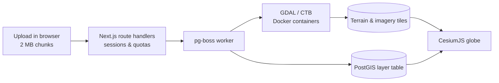

# Next.js CesiumJS 3D GIS Kit

A starter kit for building 3D WebGIS applications with **Next.js**, **CesiumJS** and **PostGIS**. Upload elevation models, orthophotos and vector data, let the queue worker convert them into Cesium-ready layers, and explore them on a 3D globe with measurement and terrain-analysis tools.

This is the Next.js port of [Laravel CesiumJS 3D GIS Kit](https://github.com/zakialawi02/laravel-cesiumjs-3d-gis-kit), built on the [Next.js + Prisma + NextAuth starter pack](https://github.com/zakialawi02/starterpack-nextjs-auth-prisma). Features, URLs and the conversion pipeline match the Laravel version; the few deliberate differences are listed in [Architecture → Differences from the Laravel version](docs/architecture.md#10-differences-from-the-laravel-version).

## Features

**Data pipeline**
- Resumable chunked uploads (2 MB chunks) with per-user quotas, disk-space checks and rate limits.
- **Terrain**: single-band DEM GeoTIFF → quantized-mesh terrain tiles (Cesium Terrain Builder), plus an optional orthophoto GeoTIFF → XYZ imagery tiles.
- **Vector**: GeoJSON, zipped Shapefile, DXF, DWG and Surpac STR → WGS84, stored as a dedicated PostGIS table per layer with the original attributes as columns. DXF colors are preserved.
- Converters (GDAL, CTB) run in network-less, read-only, resource-limited Docker containers, started by a separate queue worker (pg-boss on the same PostgreSQL database).

**3D map**
- Layer panel grouped by category, terrain + orthophoto overlay, vector rendering with labels.
- Navigation: compass/north reset, zoom, pivot camera, geolocation, coordinate picker, live WGS84 cursor coordinates.
- Measure toolbar: planar and surface distance, planar and surface area, circle radius/area.
- Vol/Profile analysis: cut & fill volume (flat, boundary or comparison terrain) and elevation profiles with an optional comparison terrain.
- Help popover with mouse, touch and keyboard hints.

**Administration**
- Two roles: **Admin** (upload, manage) and **Engineering** (view and analyse).
- Dashboard: overview, layer management (rename, recategorize, archive/restore, delete), layer categories with colors and icons, user management.
- Two sign-in methods: **username/email + password** (throttled) and **OAuth** (Discord, GitHub, Google). OAuth signs in to an existing account with the same email; optional self sign-up via `AUTH_OAUTH_ALLOW_SIGNUP`.
- Password reset by email (optional SMTP); changing or resetting a password signs out the account's other sessions.

## Tech stack

| Layer | Technology |
|---|---|
| Web app | Next.js 16 (App Router, Server Actions, route handlers), React 19, TypeScript |
| Auth | NextAuth.js v4 (credentials + OAuth, JWT sessions re-validated against the database) |
| Database | PostgreSQL + PostGIS, Prisma ORM (+ `pg` for the dynamic PostGIS tables) |
| Queue | pg-boss (PostgreSQL), separate worker process (`npm run worker`) |
| Geoprocessing | GDAL, Cesium Terrain Builder (Docker) |
| Frontend | CesiumJS 1.140, Tailwind CSS 4, shadcn/ui primitives, Lucide icons, Zustand (client state) |

## Quick start

Requirements: Node.js 22.12+ (required by pg-boss 12), PostgreSQL with PostGIS, Docker with Compose v2.

```bash
git clone <your-fork-url> nextjs-cesiumjs-3d-gis-kit
cd nextjs-cesiumjs-3d-gis-kit
cp .env.example .env              # set DATABASE_URL
npm install                       # also generates the Prisma client and copies Cesium assets
npm run generate:auth             # writes AUTH_SECRET into .env
npx prisma migrate deploy         # tables, PostGIS extension (needs a superuser) and the geodata_vectors schema
npm run db:seed                   # admin / engineering accounts + default layer categories
docker compose -f docker-compose.tools.yml pull
npm run dev:all                   # Next.js dev server + queue worker
```

Open <http://localhost:3000> and sign in with `admin` / `admin` (or `engineering` / `engineering`). These seeded passwords are for local development only; change them before exposing the app.

To enable OAuth, set the `AUTH_<PROVIDER>_ID` / `AUTH_<PROVIDER>_SECRET` pair in `.env` and register the callback URL `<APP_URL>/api/auth/callback/<provider>` (`discord`, `github` or `google`) with the provider.

## Scripts

| Script | Description |
|---|---|
| `npm run dev` | Next.js dev server (copies Cesium assets first) |
| `npm run worker` / `npm run worker:dev` | Queue worker: upload assembly, conversions, cleanup, scheduled stale-upload cleanup |
| `npm run dev:all` | Dev server and worker together |
| `npm run build` / `npm start` | Production build / server |
| `npm run db:migrate` / `npm run db:seed` / `npm run db:studio` | Prisma migrations, seed data, Prisma Studio |
| `npm run geodata:cleanup-stale` | Remove expired upload sessions and their chunks once |
| `npm run setup` | `prisma migrate deploy` + seed + production build |
| `npm run openapi:export` | Write the OpenAPI spec of the `/geodata` API to `docs/openapi.json` |
| `npm test` | Unit tests (Vitest) |
| `npm run check` | ESLint + TypeScript |

## Project structure

```
prisma/                 schema, migrations, seed
src/
├── app/
│   ├── (map)/          3D map page (/)
│   ├── (guest)/        login, forgot / reset password
│   ├── (app)/          dashboard, layer & category management, users, profile
│   ├── geodata/        JSON, tile and upload API (same URLs as the Laravel version)
│   └── api/            NextAuth (api/auth), Swagger UI and OpenAPI spec (api/api-docs)
├── components/         React components (map/, app/, ui/)
├── config/geodata.ts   upload, conversion and UTM settings
├── lib/                auth options, enums, roles, formatting, icons, browser helpers, map engine (lib/map)
├── stores/             Zustand stores (theme, dashboard UI, record dialogs)
├── server/             auth guards, HTTP helpers, storage, rate limits, queue, services, jobs, OpenAPI spec
├── worker/             queue worker entry point
└── proxy.ts            auth gate for pages and /geodata
storage/app/            private (chunks), geodata (sources), public (tiles, icons) — never served statically
deploy/                 systemd, Nginx, PM2 and logrotate examples for production
docker-compose.tools.yml  GDAL and CTB converter services
```

## Documentation

| Document | Contents |
|---|---|
| [Architecture](docs/architecture.md) | Components, HTTP API, data model, status lifecycles, upload / conversion / viewing / deletion / sign-in flows, frontend modules, security model, differences from the Laravel version. |
| [Development](docs/development.md) | Local setup, configuration reference, project structure, conventions, common tasks, testing, troubleshooting. |
| [Deployment](docs/deployment.md) | Step-by-step Ubuntu server setup (Node.js, PostgreSQL + PostGIS, Docker, systemd or PM2, Nginx + HTTPS), verification, updates, logs, security checklist, backups and restore, scaling. |
| [`deploy/`](deploy) | Example `systemd` units (web, worker), Nginx site, PM2 ecosystem file and logrotate config used by the deployment guide. |
| API reference | Swagger UI at `/api/api-docs` (signed-in users), the spec at `/api/api-docs/openapi.json`, and an exported copy in [`docs/openapi.json`](docs/openapi.json) (`npm run openapi:export`). |

## How it works



## Contributing

Issues and pull requests are welcome. Please run `npm run check` and `npm test` before opening a pull request, describe user-facing changes, and update the docs in `docs/` when behaviour changes.

## License

Released under the [MIT License](LICENSE).

## Support and Donations

If you find this project useful and would like to support its further development, you can make a donation via the following platforms:

https://ko-fi.com/zakialawi
