# Architecture

This document describes how Next.js CesiumJS 3D GIS Kit is put together: the moving parts, how data flows from an uploaded file to a 3D layer on the globe, and the main design decisions. It is the Next.js port of the Laravel kit; [section 10](#10-differences-from-the-laravel-version) lists where the two deliberately differ.

- [1. High-level overview](#1-high-level-overview)
- [2. Components](#2-components)
- [3. Data model](#3-data-model)
- [4. Lifecycles](#4-lifecycles)
- [5. Key flows (sequence diagrams)](#5-key-flows-sequence-diagrams)
- [6. Frontend architecture](#6-frontend-architecture)
- [7. Storage layout](#7-storage-layout)
- [8. Security model](#8-security-model)
- [9. Design decisions and limits](#9-design-decisions-and-limits)
- [10. Differences from the Laravel version](#10-differences-from-the-laravel-version)

## 1. High-level overview

The kit is a single Next.js (App Router) project with three runtime roles:

1. **Web** (`next start`, or `next dev` locally): renders the pages (React Server Components), runs the Server Actions of the dashboard and profile, accepts chunked uploads, and serves terrain tiles, orthophoto tiles and vector GeoJSON through route handlers.
2. **Queue worker** (`npm run worker`, a separate Node.js process): works the pg-boss queues. It assembles uploaded chunks, runs the conversion pipelines, deletes layer files, and runs the stale-upload cleanup every 30 minutes. It starts short-lived, network-less **Docker containers** (GDAL and Cesium Terrain Builder) for the heavy geoprocessing.
3. **Browser**: a CesiumJS globe driven by imperative JavaScript (`src/lib/map`) mounted by a React component. It also runs the measurement and terrain-analysis tools entirely client-side.

Both server processes share the same code base, the same `.env`, the same PostgreSQL database and the same `storage/` directory.

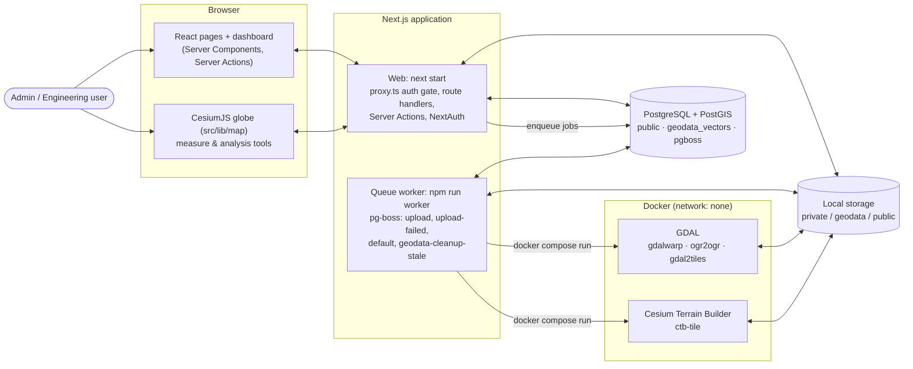

What a user can do:

| Role | Map | Upload data | Manage layers, categories and users (dashboard) |
|---|---|---|---|
| **Admin** | View layers, measure, analyse | Yes | Yes |
| **Engineering** | View published layers, measure, analyse | No | No (dashboard overview and own profile only) |

## 2. Components

### 2.1 Backend (Next.js server and worker)

| Layer | Location | Responsibility |
|---|---|---|
| Auth gate | `src/proxy.ts` | Next.js 16 "proxy" (formerly middleware). Optimistic check that a session token exists: pages redirect to `/login?redirect=…`, `/geodata/*` answers `401 {"message":"Unauthenticated."}`. Public: `/login`, `/forgot-password`, `/reset-password/*`, `/api/auth/*`, `/up` and the static folders (`/_next/static`, `/assets`, `/cesium`, favicons, `robots.txt`). |
| Authentication | `src/lib/auth.ts`, `src/app/api/auth/[...nextauth]/route.ts` | NextAuth v4 options: credentials provider (username or email + password, throttled), optional Discord / GitHub / Google OAuth, JWT sessions re-validated against the database on every read. See [section 2.4](#24-authentication-and-sessions). |
| Auth guards | `src/server/auth.ts` | `getCurrentUser()` (cached per request), `requireUser()` / `requireRole()` / `requireAdmin()` for pages and Server Actions (redirect to login, or `forbidden()` → `src/app/forbidden.tsx`), `requireApiUser(roles?)` for route handlers (401 / 403 JSON). This is where roles and revoked sessions are actually enforced. |
| Pages | `src/app/(map)`, `src/app/(guest)`, `src/app/(app)` | Map page (`/`), login / forgot / reset password, dashboard (`/dashboard`, `/dashboard/layers`, `/dashboard/layer-categories`, `/dashboard/users`) and `/profile`. |
| Server Actions | `src/app/(app)/**/actions.ts`, `src/app/(guest)/**/actions.ts` | All dashboard and profile mutations (rename / recategorize / archive / restore layers, category CRUD with icon upload, user CRUD with last-admin protection, profile and password change) and the password-reset forms. Each action re-checks the role itself. |
| Route handlers | `src/app/geodata/**`, `src/app/up` | The JSON, tile and upload API used by the map (same URLs as the Laravel version, see [section 2.5](#25-http-api)), plus the `/up` health check. |
| HTTP helpers | `src/server/http.ts` | `handler()` wrapper: same-origin check for state-changing requests, and `HttpError` / zod / storage errors turned into Laravel-shaped JSON (`{ message }`, or `{ message, errors: { field: [...] } }` with 422). `abort()`, `validate()`, `readBody()`, `clientIp()`. |
| Rate limiting | `src/server/rate-limit.ts` | In-memory fixed-window limiter with the named limits `upload-start` (20/min), `upload-chunks` (240/min), `upload-status` (120/min), `login` (20/min per IP), `login-identifier` (5 failures per identifier + IP), `forgot-password` / `reset-password` (6/min per IP), `profile-password` (6/min per user). |
| Storage | `src/server/storage.ts` | The three disks (`local`, `geodata`, `public`) under `storage/app`, with path-traversal-safe `diskPath()`. See [section 7](#7-storage-layout). |
| Upload services | `src/server/services/upload` | `upload-session-service` (quotas, idempotent sessions, chunk bookkeeping), `upload-file-validator` (magic bytes, DXF / STR patterns, full GeoJSON parse), `file-assembly-service` (stitch chunks, sha256), `shapefile-archive` (safe ZIP extraction with yauzl), `geojson-feature-reader` (streaming GeoJSON reader), `upload-completion-service` (creates source file, job and layer rows, then enqueues), `cleanup-stale-uploads`, `request-validation` (Laravel-style rule sets). |
| Conversion services | `src/server/services/conversion` | `terrain-conversion-service` (gdalinfo → gdalwarp → ctb-tile → gdal2tiles), `gdal-service` (`ogr2ogr` wrapper), `shp-import-service`, `dwg-import-service`, `surpac-str-parser-service`, `dxf-color-injector` (+ optional `parse_dxf_colors.py`), `docker` (`docker compose run` command builder, container cleanup by label). `src/server/services/process.ts` runs external commands without a shell, with timeouts and abort signals. |
| Database services | `src/server/services/database`, `src/server/db/pg.ts` | `dynamic-table-service` (one PostGIS table per vector layer in the `geodata_vectors` schema), `spatial-import-service` (batched feature import). They use a raw `pg` pool, because Prisma cannot express the dynamic DDL. |
| Layer services | `src/server/services/layers/layer-deletion-service.ts` | Layer deletion: rows in one transaction, files and tables queued for `CleanupLayerFilesJob`. |
| Jobs | `src/server/jobs` | `AssembleGeodataUpload` (queue `upload`), `ProcessGeotiffTerrain` and `ProcessVectorLayer` (extend `BaseConversionJob`), `runCleanupLayerFiles` (queue `default`), the per-conversion advisory lock (`conversion-lock.ts`) and the terminal-failure helpers (`conversion-failure.ts`). |
| Queue | `src/server/queue.ts` | pg-boss setup in the `pgboss` schema: queue definitions, retry / expiry settings, `enqueue*()` helpers used by the web process, the 30-minute schedule. |
| Worker | `src/worker/index.ts`, `src/worker/handlers.ts` | The worker process: starts pg-boss with supervision and scheduling, subscribes one handler per queue, and shuts down gracefully on SIGINT / SIGTERM. |
| Scripts | `src/scripts/cleanup-stale-uploads.ts`, `prisma/seed.ts`, `scripts/*` | `npm run geodata:cleanup-stale`, `npm run db:seed`, `npm run cesium:copy`, `npm run generate:auth`. Entry points outside Next.js import `@/server/load-env` first so `.env` is loaded. |
| Logging | `src/server/logger.ts` | Channels `app`, `terrain_conversion` and `vector_conversion`, appended to `storage/logs/<channel>.log` and echoed to the console. |
| Mail | `src/server/mail.ts` | Nodemailer SMTP transport for the password-reset mail (only when `MAIL_SMTP_ON=true`). |
| Models | `prisma/schema.prisma` | `User`, `Account`, `PasswordResetToken`, `LayerCategory`, `Layer`, `ConversionJob`, `ConversionLog`, `SourceFile`, `TerrainDetail`, `VectorDetail`, `UploadSession`. |
| Enums | `src/lib/enums.ts` | `UserRole`, `LayerType`, `LayerStatus`, `JobStatus`, `SourceFileStatus`, `SourceFileType`, `TerrainOutputType`, `VectorOutputType`. Columns are plain strings; these constants are the single source of allowed values. |
| Configuration | `src/env.ts`, `src/config/geodata.ts` | Validated environment (`@t3-oss/env-nextjs` + zod) and the geodata settings derived from it (upload limits, allowed extensions, Docker settings, UTM zone). |
| API documentation | `src/server/openapi/` | OpenAPI spec of the `/geodata` API, rendered with Swagger UI at `/api/api-docs` (`src/app/api/api-docs/`) for signed-in users and served as JSON at `/api/api-docs/openapi.json`. An exported copy lives in `docs/openapi.json` (`npm run openapi:export`). |

### 2.2 Conversion toolchain

The worker never runs GDAL or CTB on the host. It calls `docker compose -f docker-compose.tools.yml run --rm [-v …] -l conversion_job_id=<id> <service> <command>` (`src/server/services/conversion/docker.ts`), with the project root as working directory and a 7200 s process timeout. Both services share the same hardening anchor:

- `network_mode: none`, `read_only: true`, `cap_drop: [ALL]`, `no-new-privileges`, a 256 MB `tmpfs` on `/tmp`
- memory, CPU and PID limits (`GEODATA_CONVERTER_MEMORY`, default `4g`; `GEODATA_CONVERTER_CPUS`, default `2`; 128 PIDs)
- they run as `GEODATA_CONVERTER_USER` (default `1000:1000`) so output files are owned by the worker's user
- only `storage/app/geodata`, `storage/app/public/terrain-tiles` and `storage/app/public/xyz-tiles` are mounted; `ogr2ogr` runs additionally mount the input directory (read-only, except a shapefile's own temporary extraction directory) and the output directory, both inside `storage/app/geodata`

Every container carries the label `conversion_job_id=<id>`. When a conversion fails or is aborted, `killConversionContainers()` runs `docker ps -q --filter label=conversion_job_id=<id>` and `docker kill`s whatever is left.

| Service | Image | Used for |
|---|---|---|
| `gdal` | `ghcr.io/osgeo/gdal:ubuntu-full-latest` | `gdalinfo` (validate, SRS, bounding box), `gdal_translate -expand rgba` (palette rasters), `gdalwarp` (reproject DEM / orthophoto to EPSG:4326), `gdal2tiles.py` (orthophoto XYZ tiles), `ogr2ogr` (vector formats → WGS84 GeoJSON) |
| `ctb` | `tumgis/ctb-quantized-mesh:latest` | `ctb-tile` (quantized-mesh terrain tiles and `layer.json`) |

### 2.3 Frontend

React 19 with Tailwind CSS 4, shadcn/ui primitives, Lucide icons (`lucide-react` in components, SVG strings from `src/lib/icons.ts` in HTML-building code such as the map scripts) and Zustand for shared client state (`src/stores/`). The dashboard, profile and guest pages are ordinary React (Server Components plus small client components). The map page renders its markup in React, and a client component then mounts the imperative CesiumJS code from `src/lib/map` (a port of the Laravel kit's vanilla JavaScript). See [section 6](#6-frontend-architecture).

### 2.4 Authentication and sessions

- **Credentials**: username or email (lower-cased) + bcrypt password. The `authorize()` callback counts every attempt per IP (`login`, 20/min) and failed attempts per identifier + IP (`login-identifier`, 5/min, cleared on success); unknown identifiers are compared against a dummy hash so response times do not reveal accounts. Soft-deleted users cannot sign in.
- **OAuth** (optional): Discord, GitHub and Google are enabled when both `AUTH_<PROVIDER>_ID` and `AUTH_<PROVIDER>_SECRET` are set. An OAuth identity is stored in `accounts` and linked to the existing, non-deleted user with the same email. Unknown emails are refused (`?error=oauth_no_account`) unless `AUTH_OAUTH_ALLOW_SIGNUP=true`, which creates an `engineering` account without a password. Google identities with `email_verified: false` are treated as having no email.
- **Sessions** are NextAuth JWTs in an HTTP-only cookie (`next-auth.session-token`, `__Secure-` prefixed when `NEXTAUTH_URL` is https). The `jwt` callback reloads the user on every read, so role and name changes apply immediately, and a deleted user or a changed password (the token stores a 16-character fingerprint of the password hash) invalidates the token. Without "Remember me" a token expires after `SESSION_LIFETIME` idle minutes (default 120); with it, after 30 days. The `SessionProvider` refetches the session every 5 minutes and on window focus, which keeps an open tab alive.
- **Password change** (`/profile`) re-issues the current browser's cookie with the new fingerprint (`src/server/session-cookie.ts`), so only the other sessions are signed out. Admins changing their own password in the user manager get the same treatment.
- **Password reset** (`/forgot-password` → mail → `/reset-password/<token>?email=…`) is only offered with `MAIL_SMTP_ON=true`. Tokens are stored as sha256 hashes in `password_reset_tokens`, expire after 60 minutes and can be requested once per minute per email (`src/server/dashboard/password-broker.ts`). A reset changes the fingerprint and therefore signs out every session of the account.

### 2.5 HTTP API

All endpoints sit behind the proxy and re-check the session in the handler. The OpenAPI spec at `/api/api-docs` documents request and response bodies in detail.

| Method and path | Access | Purpose |
|---|---|---|
| `GET /geodata/layers/all?search=&month_year=YYYY-MM` | signed in | Published layers grouped by category (uncategorized layers merged into `other`). |
| `GET /geodata/layers/terrain?limit=` | signed in | Published terrain layers for the comparison-terrain dropdowns (limit 1–100, default 30). |
| `GET /geodata/layers/recent-uploads` | admin | Latest 10 conversion jobs for the Data panel. |
| `DELETE /geodata/layers/{layer}` | admin | Delete a layer (409 while its conversion is queued or processing). |
| `GET /geodata/layer-categories` | signed in | Categories for the upload form. |
| `GET /geodata/terrain/{layerId}/layer.json` | signed in, published | Terrain metadata with versioned tile URL templates. |
| `GET /geodata/terrain/{layerId}/{z}/{x}/{y}.terrain` | signed in, published | Quantized-mesh tile (decompressed, see [section 10](#10-differences-from-the-laravel-version)). |
| `GET /geodata/ortho/{layerId}_ortho/{z}/{x}/{y}.png` | signed in, published | Orthophoto XYZ tile. |
| `GET /geodata/vector/{layer}/data.json` | signed in, published | Streamed GeoJSON FeatureCollection of the layer's PostGIS table. |
| `GET /geodata/icons/layer-categories/{name}.(png\|webp)` | signed in | Category icon. |
| `POST /geodata/upload/sessions` | admin, `upload-start` | Start or resume an upload session (`fileName`, `fileSize`, `requestId`). |
| `GET /geodata/upload/sessions/{id}` | admin, `upload-status` | Session state for resuming (410 once expired). |
| `DELETE /geodata/upload/sessions/{id}` | admin, `upload-start` | Cancel an unsubmitted upload and delete its chunks. |
| `POST /geodata/upload/chunk` | admin, `upload-chunks` | One multipart chunk (`file` ≤ 2 MB, `identifier`, `chunkIndex`, `checksum` = sha256). |
| `POST /geodata/upload/assemble-raster` | admin, `upload-start` | Complete a DEM (+ optional orthophoto) upload; 202 with `job_id`. |
| `POST /geodata/upload/assemble-vector` | admin, `upload-start` | Complete a vector upload; 202 with `job_id`. |
| `GET /geodata/upload/status/{job}` | admin (uploader only), `upload-status` | Job status for polling, with layer details once done. |
| `GET /up` | public | Health check: `{"status":"up"}` when the database answers, 503 otherwise. |
| `/api/auth/*` | public | NextAuth endpoints (sign-in, callbacks, session, CSRF token, sign-out). |

The dashboard's mutations are Server Actions, not part of this API; the only dashboard call into it is the layer deletion.

## 3. Data model

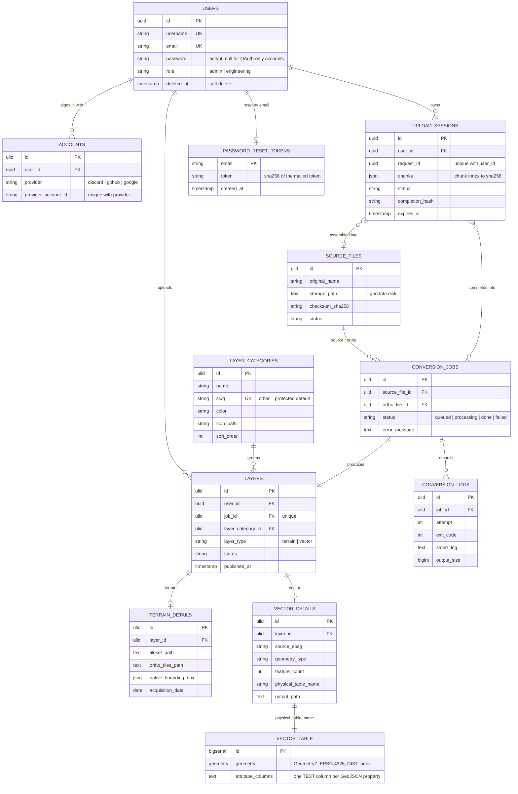

The database has three schemas:

| Schema | Owner | Contents |
|---|---|---|
| `public` | Prisma migrations (`prisma/migrations`) | The models above. The first migration also runs `CREATE EXTENSION IF NOT EXISTS postgis` and `CREATE SCHEMA IF NOT EXISTS geodata_vectors`. |
| `geodata_vectors` | `dynamic-table-service` at runtime | One table per vector layer, `vector_<lower-cased layer ulid>`. Prisma never sees them, so `prisma migrate dev` reports no drift. |
| `pgboss` | pg-boss (created on its first start) | Queues, jobs, schedules. |

Notes:

- Column names stay snake_case so raw SQL, API payloads and the ported frontend share one vocabulary.
- Every vector layer gets its **own PostGIS table** with one sanitized `TEXT` column per GeoJSON property (max 256 properties; `id`, `geometry`, `created_at`, `updated_at` are prefixed with `attr_`). Table and column names are generated server-side and validated against `^vector_[a-z0-9_]{1,60}$` before any DDL; feature values and geometries are bound parameters.
- `layers.job_id` is unique: one conversion job produces exactly one layer.
- Users are soft-deleted (`deleted_at`); their layers keep `user_id` until a hard delete sets it to null.
- Deleting a category moves its layers to the protected `other` category in the same transaction.

## 4. Lifecycles

### 4.1 Layer status

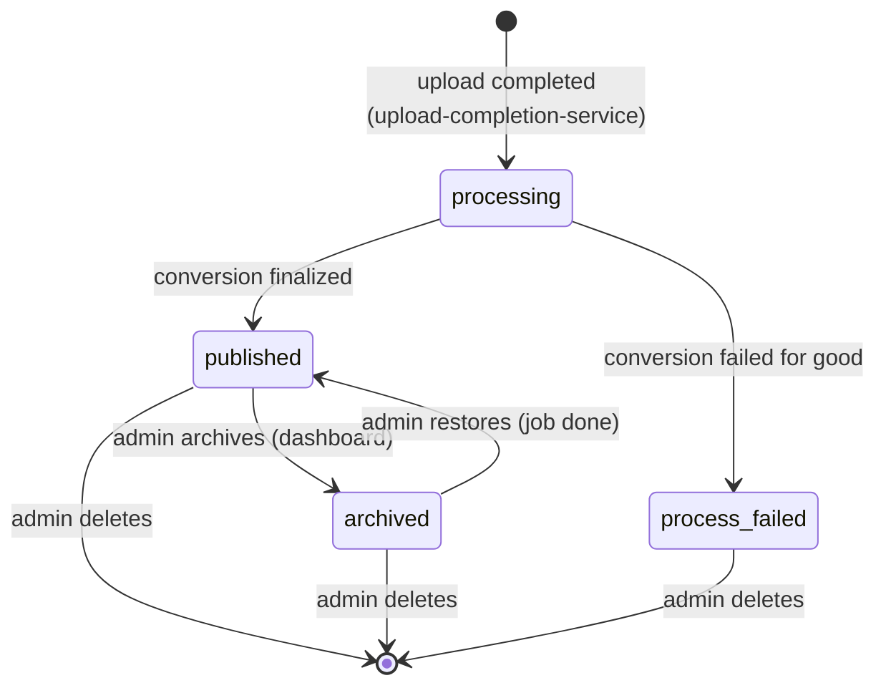

Only **published** layers are listed on the map and served by the tile and GeoJSON endpoints. Deleting a layer is refused (HTTP 409) while its conversion is still queued or processing, unless the job has not been updated for more than three hours (`STALE_JOB_SECONDS`, longer than the 7200 s conversion limit). The enum also defines `pending` and `queued`, but the current code never assigns them.

### 4.2 Conversion job status

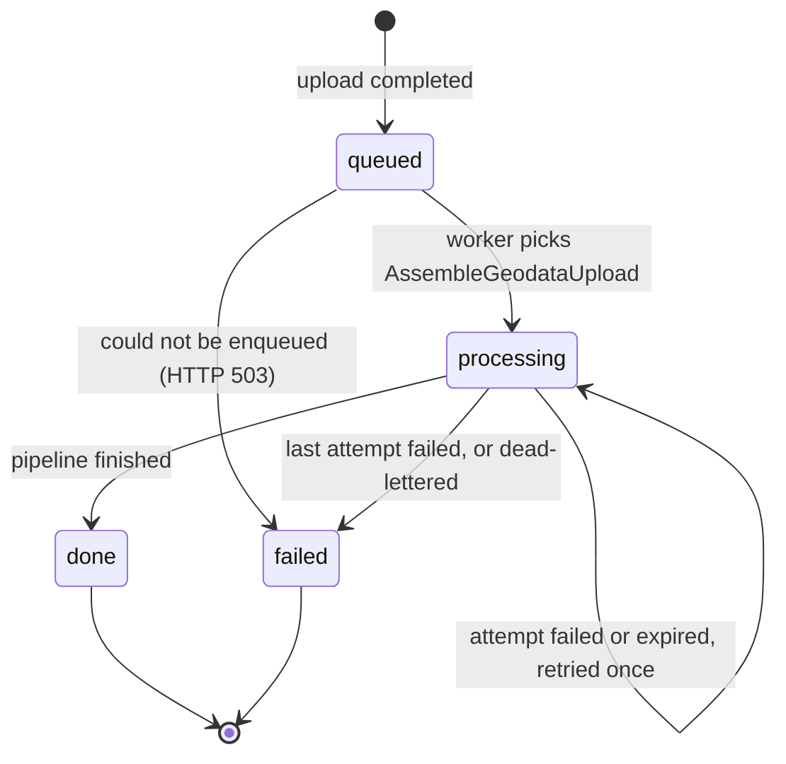

Retry and timeout rules (`src/server/queue.ts`):

- Every job gets **one retry** (`retryLimit: 1`, no delay) and **7200 s** (`expireInSeconds`). A failed first attempt leaves the job `processing` and closes its `conversion_logs` row; only the last attempt marks the job `failed` and the layer `process_failed`, so the UI never reports a terminal failure that is about to be retried.
- When the last attempt fails, times out, or its worker dies, pg-boss moves the job to the dead-letter queue `upload-failed`, whose handler runs `AssembleGeodataUpload.failed()`: kill leftover containers, mark the job failed, the layer `process_failed`, the upload sessions `failed` and still-uploading source files `invalid`. A job that finished despite losing its reservation is left `done`.
- The `upload` queue uses the pg-boss `singleton` policy keyed by the conversion job id, and the handler holds a Postgres advisory lock (`pg_try_advisory_lock(hashtextextended('geodata:<id>', 0))`) while it runs. If another worker still holds the lock, the job is put back with a 60 s delay, at most `ceil((7200 + 200) / 60)` times.

### 4.3 Upload session status

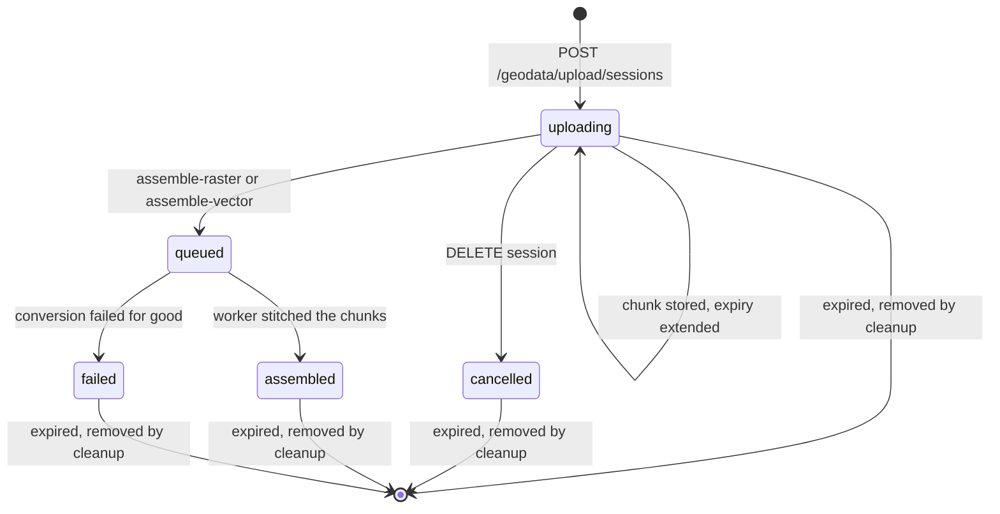

Sessions expire `GEODATA_UPLOAD_SESSION_HOURS` (default 24) after the last stored chunk. `queued` sessions are never removed by the cleanup: their inputs belong to the worker until it finishes.

## 5. Key flows (sequence diagrams)

### 5.1 Chunked upload and completion

Uploads are split into 2 MB chunks so large GeoTIFFs survive flaky connections and can resume (the browser remembers session ids in `localStorage`). Quotas (`GEODATA_UPLOAD_MAX_SESSIONS`, `GEODATA_UPLOAD_MAX_INFLIGHT_MB`, `GEODATA_MIN_FREE_DISK_MB`) and per-user rate limits (`upload-start`, `upload-chunks`, `upload-status`) are enforced server-side. The browser computes each chunk's sha256 with `crypto.subtle`, which only exists in a secure context (HTTPS or `localhost`).

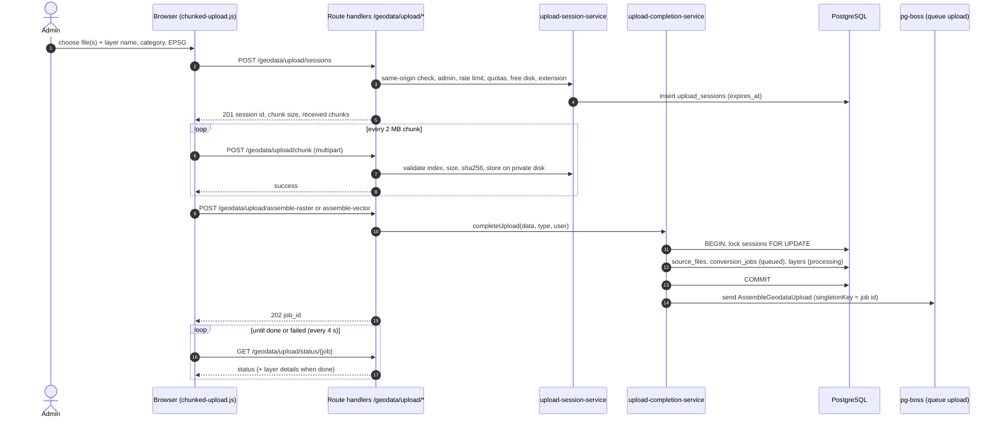

Completion is **idempotent**: the normalized request parameters are hashed into `upload_sessions.completion_hash`, so a retried "assemble" call returns the same job, while a call with different parameters is rejected with 409. The job is enqueued only after the transaction committed; if pg-boss cannot accept it, the job is marked `failed` right away and the request answers 503, so the UI never waits on a job nobody runs.

### 5.2 Terrain conversion (GeoTIFF DEM + optional orthophoto)

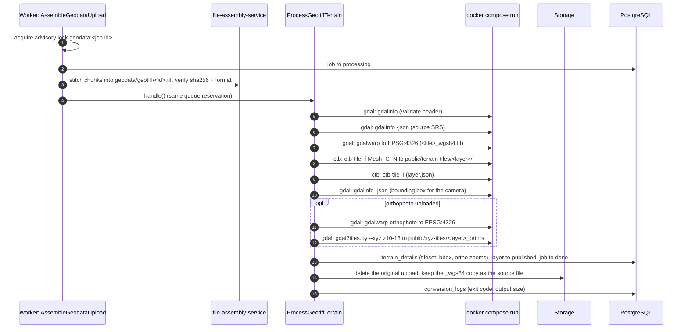

Palette (colour-table) rasters are expanded to RGBA with `gdal_translate -expand rgba` before `gdalwarp`. Every step first checks the job's abort signal, so a timed-out or shutting-down job stops between steps.

### 5.3 Vector conversion (GeoJSON, zipped Shapefile, DXF, DWG, Surpac STR)

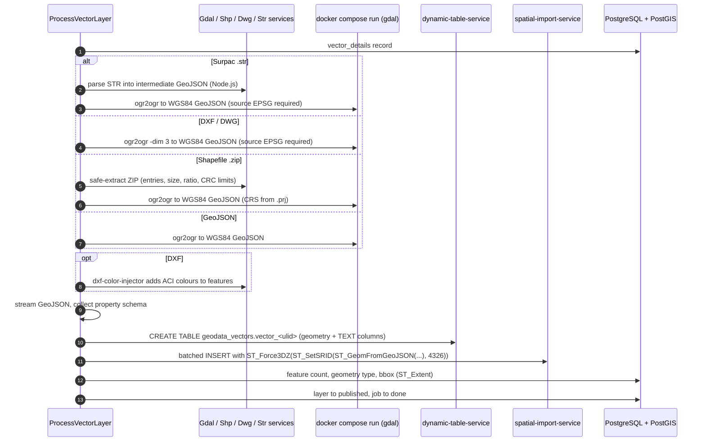

The converted GeoJSON is kept at `storage/app/geodata/geojson/vector_<layer>.geojson` next to the source file.

### 5.4 Viewing a layer on the map

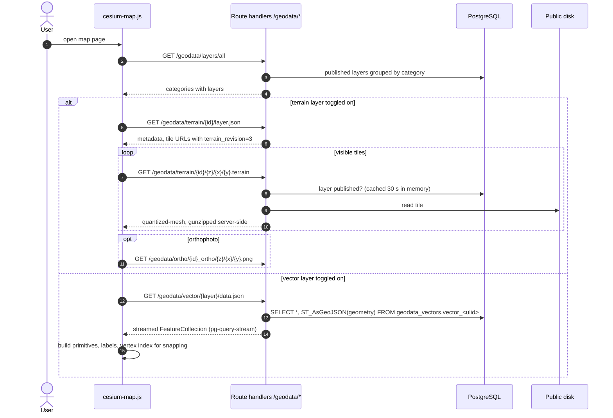

Tile responses carry `Cache-Control: private, max-age=604800` (they require a session); `layer.json` is `no-cache` and versions its tile URLs (`terrain_revision`) so browsers drop stale tiles after the encoding changed.

### 5.5 Measurement and terrain analysis (client-side)

The measure tools and the Vol/Profile panel run entirely in the browser. They sample heights from the terrain currently loaded in Cesium; no server round-trip is involved except fetching the comparison-terrain list.

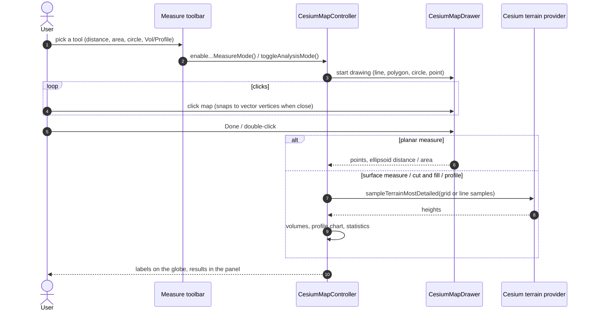

### 5.6 Deleting a layer

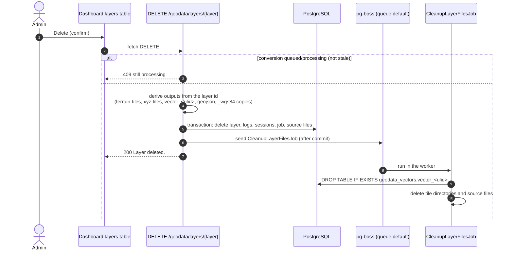

If the queue is unavailable, the web process runs the cleanup itself instead of leaving files behind.

### 5.7 Sign-in and session validation

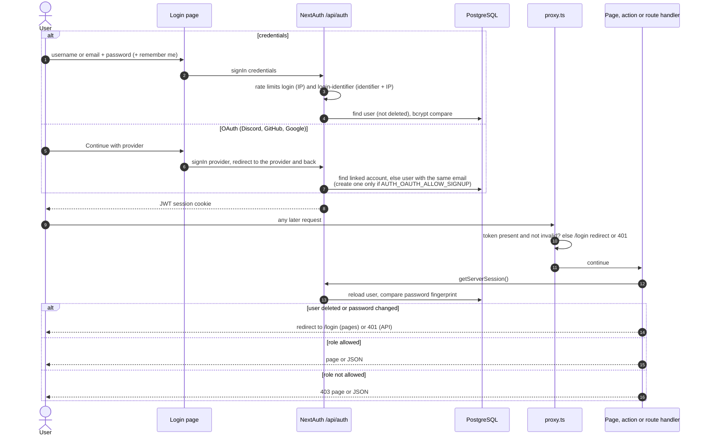

## 6. Frontend architecture

| File | Role |
|---|---|
| `src/app/layout.tsx` | Root layout: fonts, `globals.css`, an inline boot script (stored theme before first paint, `window.APP_GIS_CONFIG` with the UTM settings from `src/config/geodata.ts`, `window.CESIUM_BASE_URL = "/cesium/"`), the top loader, the NextAuth `SessionProvider`, the toast container and `<ClientBootstrap>`. |
| `src/components/client-bootstrap.tsx` | Installs the browser globals the vanilla scripts rely on (`escapeHtml`, `safeColor`, `parseTimestamp`, `matchMonthYear`, `formatIndonesianCoordinate`, `formatNumber`, `MyZkToast`, `ZkPopAlert`) and shows one-time flash toasts set by Server Actions (`flash` cookie, `src/server/flash.ts`). |
| `src/lib/client/*` | `helpers.ts` (escaping and formatting), `toast.ts` (`MyZkToast`), `popup-alert.ts` (`ZkPopAlert` / `confirmPopup()`), `theme.ts` (`useTheme()` hook over the theme store). |
| `src/stores/*` | Zustand stores: `theme-store.ts` (vanilla store: light / dark via the `dark` class on `<html>`, persisted in `localStorage` under `hs_theme`, readable from the map scripts too; the key and the pre-paint script live in `src/lib/theme-script.ts`), `ui-store.ts` (dashboard off-canvas sidebar), `record-dialog-store.ts` + `scoped-store.tsx` (per-page store, created by a Provider, that lets list rows, the header and the modals share which record's dialog is open). |
| `src/lib/icons.ts` | Lucide icons as SVG markup for code that builds HTML strings (map scripts, popup alert); React components import `lucide-react` directly. Only icons listed in `ICONS` are bundled. |
| `src/app/(map)/page.tsx`, `src/components/map/**` | Server-rendered map markup: command bar, Layers / Data / Help / Analysis panels, tool rail, overlays, mobile nav and upload modal, with the same ids, classes and `data-*` hooks as the Laravel Blade views. `<MapEngine>` (client component) dynamically imports `src/lib/map/mount.js` so Cesium never runs on the server. |
| `src/lib/map/mount.js` | `mountMap({ userRole, maxUploadMb })`: installs the map globals, then starts `ui-interactions`, the upload modal, the page script and the Cesium controller, in that order. Returns `unmountMap()`, which removes every listener, timer and observer and destroys the viewer. |
| `src/lib/map/globals.js` | proj4 with the configured UTM zone, `longLatToUtm`, `cartesianToCoords`, `openModal` / `closeModal`, `UTM_*` and `WGS84_EPSG` on `window`. |
| `src/lib/map/ui-interactions.js` | Vanilla modals (`data-modal`), accordions, tabs, dismissible messages and the off-canvas sidebar. Every initializer returns a cleanup function. |
| `src/lib/map/map-page.js` | Page script: side panels and shortcuts (`L` layers, `D` data, `Esc`), account menu, layer list, recent uploads, upload submission with progress cards, coordinate copy. Installs `window.cleanupMapPage()`. |
| `src/lib/map/cesium-map.js` | `CesiumMapController`: viewer setup, navigation (compass, zoom, pivot camera, geolocation, coordinate picker, depth test against terrain), terrain / ortho / vector layers, measurement and Vol/Profile analysis; `initMapPage()` wires the controls. |
| `src/lib/map/cesium-drawer.js` | `CesiumMapDrawer`: interactive point / line / polygon / circle drawing with undo and vertex snapping. |
| `src/lib/map/cesium-measure.js` | Distance, surface distance, area, surface area and circle measures built on the drawer. |
| `src/lib/map/upload/*` | Chunked, resumable upload client, upload modal wiring, job-status polling (every 4 s with back-off) and the pause / resume / cancel buttons. |
| `src/lib/map/utils/*` | Constants (UTM config from `window.APP_GIS_CONFIG`), map performance tuning, terrain provider cache, vector vertex index for snapping. |
| `src/lib/map/templates.ts` | HTML templates for the map lists (ports of the Blade components that Laravel embedded in JavaScript template literals). |
| `src/app/(app)/**`, `src/components/app/**` | Dashboard shell and pages. Lists are Server Components reading Prisma; forms and tables are client components that call Server Actions and show the returned message as a toast. |
| `src/app/(guest)/**` | Login (credentials form plus one button per configured OAuth provider), forgot password, reset password. |
| `src/components/ui/*` | shadcn/ui primitives (Radix based). |

### 6.1 Map mount lifecycle

The map scripts are imperative and assume they own the DOM below `#mapApp`. React renders that markup once and then hands over:

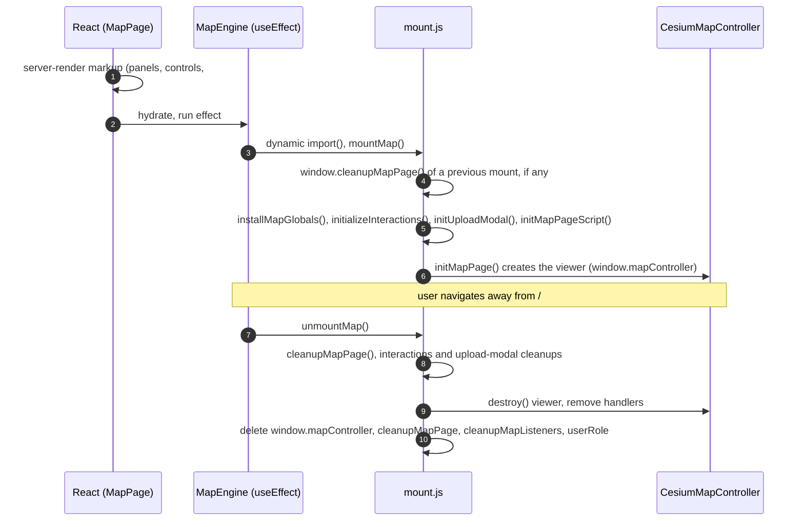

`reactStrictMode` is off in `next.config.ts` so development does not mount the viewer twice. If WebGL is unavailable, the viewer fails to start but the panels keep working.

Map lists (layers, recent uploads) are rendered from JSON with the templates in `src/lib/map/templates.ts`. Every user-controlled value passes through `escapeHtml`, and category colours are filtered through `safeColor` before they reach `style` attributes.

### 6.2 Cesium static assets

Cesium's static runtime files (`Workers`, `Assets`, `ThirdParty`, `Widgets`) are copied from `node_modules/cesium/Build/Cesium` to `public/cesium` by `scripts/copy-cesium-assets.mjs`. It runs after `npm install` (postinstall) and before `npm run dev`, `npm run dev:all` and `npm run build`, and skips the copy when `public/cesium/.version` already matches the installed Cesium version. `public/cesium` is git-ignored. Cesium's widget CSS is imported by `map-engine.tsx`.

## 7. Storage layout

| Disk / path | Contents | Public? |
|---|---|---|
| `storage/app/private/temp_chunks/<session>/<n>.part` (`local` disk) | In-flight upload chunks | No |
| `storage/app/geodata/geotiff`, `…/vectors`, `…/geojson`, `…/temp` (`geodata` disk) | Assembled sources, reprojected `_wgs84.tif` copies, converted GeoJSON, temporary shapefile extractions | No |
| `storage/app/public/terrain-tiles/<layer ulid>` (`public` disk) | Quantized-mesh tiles (gzip on disk) + `layer.json` | Served through `/geodata/terrain/*` (auth + published check) |
| `storage/app/public/xyz-tiles/<layer ulid>_ortho` | Orthophoto PNG tiles | Served through `/geodata/ortho/*` (auth + published check) |
| `storage/app/public/icons/layer-categories` | Category icons (PNG / WebP, ≤ 512 KB, ≤ 512×512 px) | Served through `/geodata/icons/*` (auth) |
| `storage/logs/<channel>.log` | `app.log`, `terrain_conversion.log`, `vector_conversion.log` | No |

Despite its name, the `public` disk is **never served statically**: nothing under `storage/` is linked into `public/`, and every file goes through an authenticated route handler. Only `public/` (the Cesium assets, images) and the build output are static. Do not symlink storage into `public/`: tiles would become reachable without a session.

`docker-compose.tools.yml` bind-mounts `./storage/app/…` relative to the project root, so the storage directory must stay at `<project>/storage` (the undocumented `STORAGE_PATH` override in `src/server/storage.ts` would break those mounts).

## 8. Security model

- **Authentication**: NextAuth with credentials (username or email + password) and optional OAuth. Logins are throttled per IP and per identifier + IP. Sessions are JWTs re-validated against the database on every request; deleting a user, or changing / resetting a password, invalidates their other sessions. The proxy only checks that a token exists; the real checks happen in `src/server/auth.ts`.
- **Authorization**: two roles. Uploads, deletion, the recent-uploads list and the data / user management dashboard are admin-only; every page, Server Action and route handler checks the role itself (`requireAdmin()` / `requireApiUser("admin")`), the navigation only hides links. Users cannot delete themselves or drop their own admin role, and the last admin cannot be demoted or deleted (admin rows are locked `FOR UPDATE`).
- **CSRF**: Server Actions get Next.js's built-in origin check. State-changing route handlers go through `assertSameOrigin()`: the `Origin` header must match the request origin, the forwarded host (`x-forwarded-proto` / `x-forwarded-host`), or `APP_URL`; without an `Origin`, `Sec-Fetch-Site` must be `same-origin` or `none`. Mismatches get 419. NextAuth uses its own CSRF token.
- **Input handling**: upload extensions are allow-listed; assembled files are checked against their claimed format; ZIP extraction enforces entry count, uncompressed size, compression ratio, safe names, no links / special / encrypted entries and CRC; GeoJSON and STR files are read by streaming parsers with attribute (256) and vertex (100,000 per STR segment) limits; dynamic SQL identifiers are generated and pattern-checked server-side; feature values are bound parameters; storage paths cannot escape their disk.
- **Isolation of untrusted files**: GDAL (`gdal`, `gdal-vector`) and CTB parse uploaded files only inside network-less, read-only, capability-dropped containers with resource limits. The optional host-side Python DXF colour parser (`GEODATA_ENABLE_PYTHON_COLOR_PARSER`) is off by default.
- **Serving**: tiles, GeoJSON and icons are only served to authenticated users, and tiles and GeoJSON only for published layers; tile routes are constrained to 26-character layer ids and numeric z/x/y.
- **Output encoding**: React escaping on the server and in components; `escapeHtml` and `safeColor` in the vanilla map scripts. In production, unexpected errors return `{"message":"Server Error"}` without details.
- **Client IPs** for rate limits come from `X-Forwarded-For`, counted `TRUSTED_PROXY_COUNT` hops from the right (the entries our own proxies appended; the client-supplied left part is ignored), then `X-Real-IP` (`src/server/client-ip.ts`). Logins are additionally limited per account regardless of IP (20 failures per 15 minutes).
- **OAuth linking** only uses an email the provider reports as verified (Google `email_verified`, Discord `verified`, GitHub primary *verified* address) and only links to accounts whose own email is verified; changing your email in the profile clears that flag.
- **Vector conversion** runs in the `gdal-vector` service, which has no base volumes (only the per-run input and output mounts), with the input driver named explicitly (`-if`). Files served to users are resolved with `realpath` and must stay inside their storage disk, so a symlink planted by a converter cannot expose host files.

See [deployment.md](deployment.md#8-security-checklist) for the production checklist.

## 9. Design decisions and limits

| Decision | Why |
|---|---|
| One PostGIS table per vector layer, in its own schema | Keeps original attributes as real columns instead of a JSON blob and lets each layer be dropped cleanly; the separate `geodata_vectors` schema keeps them out of Prisma's migration diff. |
| Converters in Docker, not on the host | GDAL / CTB parse untrusted binary formats; containers give isolation and reproducible tool versions without installing GDAL on the server. |
| Separate worker process with pg-boss | Conversions take up to two hours and must survive web restarts; pg-boss reuses the PostgreSQL database instead of adding Redis. |
| Assembly and conversion in one queue reservation | No hand-off window where a job could be lost between "assembled" and "converting". |
| JWT sessions re-validated against the database | No session table to clean up, but roles, deletions and password changes still take effect on the next request (one primary-key lookup per authenticated request). |
| Server Actions for the dashboard, route handlers for the map API | The dashboard is React and benefits from typed actions and `revalidatePath`; the map's vanilla scripts and the upload client need stable JSON URLs (kept identical to the Laravel version). |
| Map engine kept as imperative JavaScript | CesiumJS is imperative and the Laravel scripts were already tested; React renders the markup and manages mount / unmount only. |
| Client-side measurement and analysis | Uses the exact terrain the user sees, no extra server load, works offline once tiles are cached. |
| In-memory rate limiter and published-layer cache | No extra infrastructure for a single `next start` instance; see the scaling notes in [deployment.md](deployment.md#11-scaling-notes). |

Known limits:

- Converters must run on the same host as `storage/` (bind mounts are relative to the project).
- One worker runs one upload job at a time (`localConcurrency: 1`); run more worker processes for parallel conversions.
- Rate limits and the 30 s "layer published" cache live in process memory: they reset on restart and are per instance.
- Cut & fill and profile need an active terrain layer; very large areas at fine resolution are refused client-side to keep the browser responsive.
- The terrain pipeline expects single-band DEM GeoTIFFs; LAS / LAZ, OBJ and glTF are defined in `SourceFileType` but have no pipeline yet.
- `GEODATA_TERRAIN_MIN_ZOOM` / `GEODATA_TERRAIN_MAX_ZOOM` are read into `geodataConfig.terrain` but not passed to `ctb-tile` (as in the Laravel version), so CTB builds its default pyramid. Orthophoto tiles are always generated for zoom 10–18.

## 10. Differences from the Laravel version

URLs, payloads, the database vocabulary and the conversion pipeline follow the Laravel kit. These differences are deliberate:

| Area | Laravel | Next.js |
|---|---|---|
| Vector tables | `vector_<ulid>` in the default schema | `geodata_vectors.vector_<ulid>`, a schema created by the first migration, so Prisma never sees the tables. |
| Terrain tiles | Sent gzip-compressed as stored, with `Content-Encoding: gzip` | Gunzipped server-side, because Next.js drops `Content-Encoding` from route handler responses (the browser would otherwise receive raw gzip bytes). `layer.json` carries `terrain_revision=3` so cached gzip tiles are not reused. |
| Sign-in | Session login with username or email | NextAuth credentials **plus optional OAuth** (Discord, GitHub, Google), linked by email, with optional self sign-up (`AUTH_OAUTH_ALLOW_SIGNUP`). |
| Sessions | Database sessions, `authenticateSessions()` | JWTs re-validated against the database; a password-hash fingerprint in the token replaces session regeneration. |
| Queue and scheduler | Database queue, `queue:work`, cron + `schedule:run` | pg-boss in the `pgboss` schema; the worker also runs the 30-minute schedule, so no cron entry is needed. Overlap protection uses the `singleton` policy plus a Postgres advisory lock. |
| CSRF | `X-CSRF-TOKEN` header | Same-origin check (`Origin` / `Sec-Fetch-Site`) in route handlers, built-in protection for Server Actions. |
| Shapefile ZIPs | `.shp .shx .dbf .prj .cpg .sbn .sbx .qix .xml` | The same plus `.qmd` (QGIS layer metadata), so QGIS exports upload without repacking. |
| Shapefile conversion | Input directory mounted read-only | The shapefile's temporary extraction directory is mounted writable, because `SHAPE_RESTORE_SHX` makes current GDAL rewrite the `.shx`. |
| Surpac STR | Only `0, 0, 0, 0` ended a segment; the axis record (string number 0 with real coordinates) became a vertex | Any record with string number 0 ends a segment and is never a vertex. |
| Container cleanup | `--filter "label=conversion_job_id='<id>'"`: the quoted value never matched, leftover containers were not killed | Arguments are passed without a shell, so the label filter matches and leftovers are killed. |
| GeoTIFF CRS detection | First `ID["EPSG",n]` in the WKT (often the base CRS or a unit) | Last `ID["EPSG",n]`, which is the CRS's own id. |
| Logs | `laravel.log` plus daily-rotated conversion channels | `storage/logs/app.log`, `terrain_conversion.log`, `vector_conversion.log`, appended without rotation (see the logrotate example in `deploy/`). |
| User management | Dashboard users page | Same, as Server Actions with row locks against concurrent last-admin changes. |
